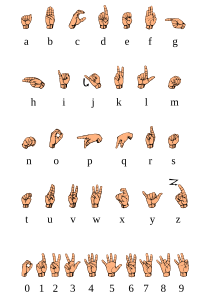

# HandSpell - Reading hands, one letter at a time

American Sign Language (ASL) Package and API.
Provides:
- Links to public ASL datasets
- Python package to explore, process and train models based on those datasets
- API to assess the ASL letter from an image

## Why?
Around 70 million deaf people use sign language, yet most hearing people can't
read a single sign.
We want to build a bridge, one letter at a time.

## Who?

Originally an educational group project to practice Data Science & AI skills.

Pitched project [presentation](
https://docs.google.com/presentation/d/1jcQMq_tmHvUgpGdeSIOcO710AYkrgIvgbfjN2BN1O7g/edit?slide=id.p1#slide=id.p1) by Afonso Silva in October 2026.

Original team members:
- Afonso Silva - [LinkedIn]
- Delphine Pessoa - [LinkedIn](https://www.linkedin.com/in/delphine-pessoa/)
- Maximilian Greger - [LinkedIn](https://www.linkedin.com/in/maximilian-greger-77595b289/)
- Kazim Hussain Mohammed - [LinkedIn]

# API

Interactive API documentation:
- Kazim deployment [link](https://handspell-api-77400974703.europe-west1.run.app/docs)
- Delphine deployment [temporary_link](https://handspell-api-390650046032.europe-west1.run.app/docs)

- [TODO] Document main API endpoints here

# Usage
- [TODO] Document main functionalities of the package here

# Setup instructions
- [TODO] Document here for users who want to setup the package locally
