# Datasets

## A. Static Cropped Labeled Images

### A01 - Sign Language MNIST (Kaggle: ([link](https://www.kaggle.com/datasets/datamunge/sign-language-mnist?select=sign_mnist_test))

- Author: [tecperson](https://www.kaggle.com/datamunge)
- License: [CC0: Public Domain](https://creativecommons.org/publicdomain/zero/1.0/)

- 34,627 images (pre-split into 27,455 train & 7,172 test)
- 24 labels (['A', 'B', 'C', 'D', 'E', 'F', 'G', 'H', 'I', 'K', 'L', 'M', 'N', 'O', 'P', 'Q', 'R', 'S', 'T', 'U', 'V', 'W', 'X', 'Y'])
- images 28x28 pixels
- All greyscale images (1 channel)

Result of applying a pre-processing pipeline to 1,704 color images, see `B01_original_aslmnist` - based on ImageMagick:
  - crop hands only
  - grey-scale
  - resize
  - data augmentation
    - filters ('Mitchell', 'Robidoux', 'Catrom', 'Spline', 'Hermite')
    - 5% random pixelation
    - +/- 15% brightness/contrast
    - 3 degrees rotation

Each training and test case represents a label (0-25) as a one-to-one map for each alphabetic letter A-Z (and no cases for 9=J or 25=Z because of gesture motions). The training data (27,455 cases) and test data (7172 cases) are approximately half the size of the standard MNIST but otherwise similar with a header row of label, pixel1,pixel2….pixel784 which represent a **single 28x28 pixel image with grayscale values between 0-255**.

The original hand gesture image data represented multiple users repeating the gesture against different backgrounds.

The Sign Language MNIST data came from greatly extending the small number (1704) of the color images included as not cropped around the hand region of interest.

To create new data, **an image pipeline** was used **based on ImageMagick** and included **cropping to hands-only, gray-scaling, resizing, and then creating at least 50+ variations to enlarge the quantity**. The modification and expansion strategy was filters ('Mitchell', 'Robidoux', 'Catrom', 'Spline', 'Hermite'), along with 5% random pixelation, +/- 15% brightness/contrast, and finally 3 degrees rotation.

Because of the tiny size of the images, these modifications effectively alter the resolution and class separation in interesting, controllable ways.

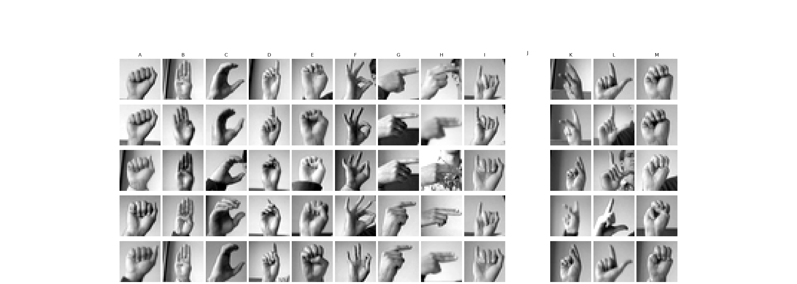
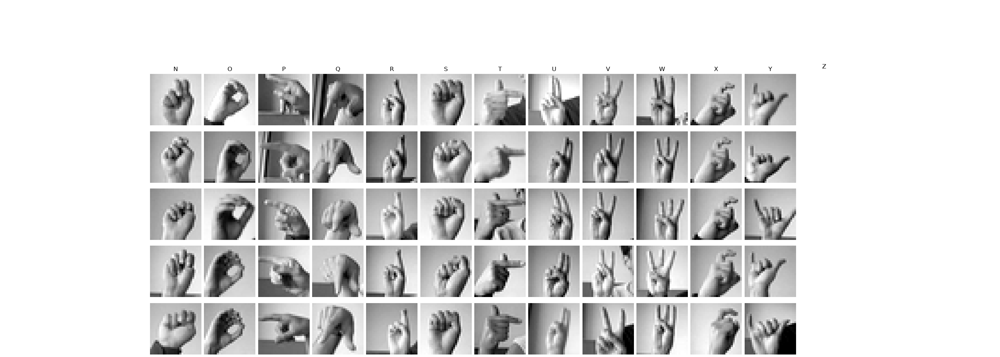

### A02 - Sign Language Gesture Images Dataset (Kaggle: [link](https://www.kaggle.com/datasets/ahmedkhanak1995/sign-language-gesture-images-dataset))

- Author: [Ahmed Khan](https://www.kaggle.com/ahmedkhanak1995)
- License: [EU ODP Legal Notice](https://ec.europa.eu/info/legal-notice_en)

- 55,500 images
- 37 labels (['0', '1', '2', '3', '4', '5', '6', '7', '8', '9', 'A', 'B', 'C', 'D', 'E', 'F', 'G', 'H', 'I', 'J', 'K', 'L', 'M', 'N', 'O', 'P', 'Q', 'R', 'S', 'T', 'U', 'V', 'W', 'X', 'Y', 'Z', '_'])
  - 10 numbers (0 to 9)
  - 26 letters (A-Z)
  - space
- images 50x50 pixels
- All color images (3 channels)

The dataset consists of 37 different hand sign gestures which includes A-Z alphabet gestures, 0-9 number gestures and also a gesture for space which means how the deaf or dumb people represent space between two letter or two words while communicating. The dataset has two parts, that is two folders (1)-Gesture Image Data - which consists of the colored images of the hands for different gestures.

Each gesture image is of size 50X50 and is in its specified folder name that is A-Z folders consists of A-Z gestures images and 0-9 folders consists of 0-9 gestures respectively, '_' folder consists of images of the gesture for space.

Each gesture has 1500 images, so all together there are 37 gestures which means there 55,500 images for all gestures in the 1st folder and in the 2nd folder that is (2)-Gesture Image Pre-Processed Data which has the same number of folders and same number of images that is 55,500. The difference here is these images are threshold binary converted images for training and testing purpose. Convolutional Neural Network is well suited for this dataset for model training purpose and gesture prediction.

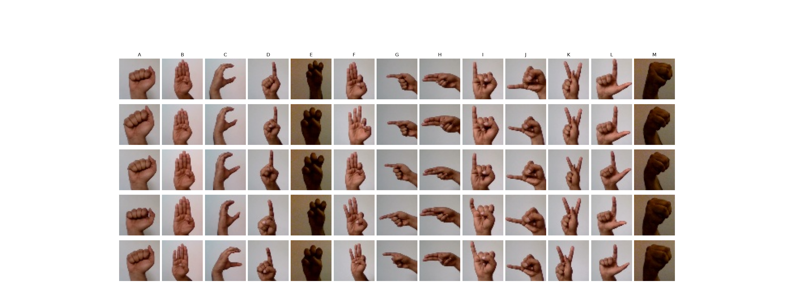
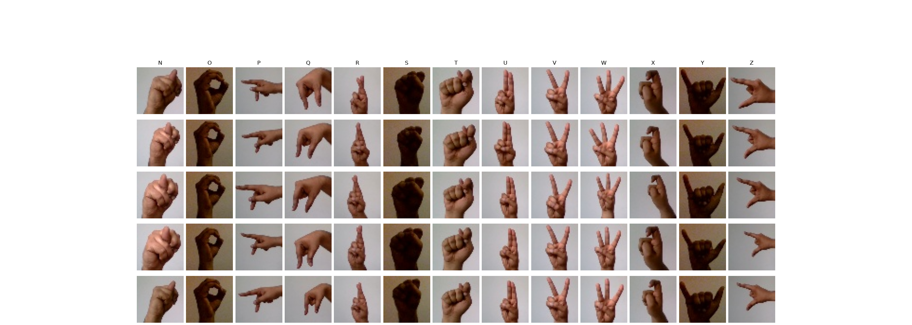

### A03 - American Sign Language (ASL) Dataset (Kaggle: [link](https://www.kaggle.com/datasets/prathumarikeri/american-sign-language-09az))

- Author: [Prathum Arikeri](https://www.kaggle.com/prathumarikeri)
- License: [CC BY-SA 4.0](https://creativecommons.org/licenses/by-sa/4.0/)

- 142,261 images
- 36 labels (['0', '1', '2', '3', '4', '5', '6', '7', '8', '9', 'A', 'B', 'C', 'D', 'E', 'F', 'G', 'H', 'I', 'J', 'K', 'L', 'M', 'N', 'O', 'P', 'Q', 'R', 'S', 'T', 'U', 'V', 'W', 'X', 'Y', 'Z'])
- images ranging from 50 to 400 in pixel width
- images from 50 to 400 in pixel height
- All color images (3 channels)

ASL dataset was created by combining author's self-made dataset with other small and large datasets found across GitHub and Kaggle.

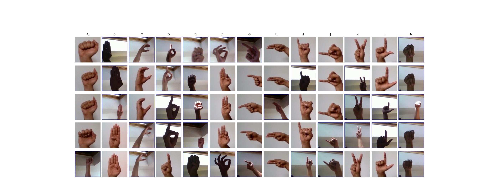
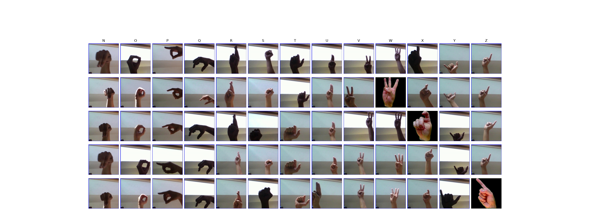

### A04 - ASL-HG: American Sign Language Hand Gesture Image Dataset (Mendeley: [link](https://data.mendeley.com/datasets/j4y5w2c8w9/1))

- Authors: Pranto, Md. Famidul Islam ; Islam, Md. Rifatul; Akbor, Md. Ali; Ghosh, Nabonita; Alam, Md. Rahatun; Chaki, Sudipto; Islam, Md Masudul (2025), “ASL-HG: American Sign Language Hand Gesture Image Dataset”, Mendeley Data, V1, doi: 10.17632/j4y5w2c8w9.1
- License: [CC BY-SA 4.0](https://creativecommons.org/licenses/by-sa/4.0/)

- 36,000 images
- 36 labels (['0', '1', '2', '3', '4', '5', '6', '7', '8', '9', 'A', 'B', 'C', 'D', 'E', 'F', 'G', 'H', 'I', 'J', 'K', 'L', 'M', 'N', 'O', 'P', 'Q', 'R', 'S', 'T', 'U', 'V', 'W', 'X', 'Y', 'Z'])
- 10 different people
- images 300x300 pixels
- All color images (3 channels)

This dataset provides a comprehensive collection of American Sign Language (ASL) hand gesture images designed to support research in gesture recognition, computer vision, deep learning, and assistive communication technologies. The dataset consists of 36,000 high-resolution JPG images across 36 ASL classes, covering the full English alphabet (A–Z) and digits (0–9).

Data were collected from 10 volunteers in Mirpur, Dhaka, Bangladesh during May–June 2025. Each participant contributed 100 images per class, producing a balanced dataset of 1,000 images for each gesture category. Images were captured using smartphone HD cameras in both indoor and outdoor environments to ensure diversity in lighting, backgrounds, skin tones, and hand orientations.

To avoid class confusion between the visually similar gestures for the letter “O” and the digit “0”, the dataset explicitly includes the standard two-handed ASL sign for “zero,” which is commonly used in real-world alphanumeric communication. This distinction supports more accurate gesture-based recognition across alphabetic and numeric classes.

With its balanced distribution, high quality, and dual-format availability (raw + processed), this dataset stands as a state-of-the-art ASL gesture resource. It is suitable for research in sign language recognition, assistive technology, human–computer interaction, gesture-controlled systems, and pattern recognition benchmarking.

#### ASL_Raw_Images.zip

1. Contains the original unprocessed gesture images.
2. Preserves natural variations in lighting, background, angle, and hand shape.

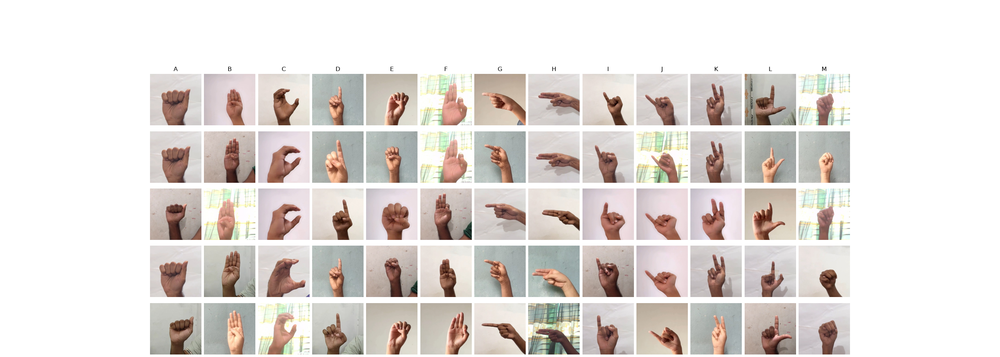
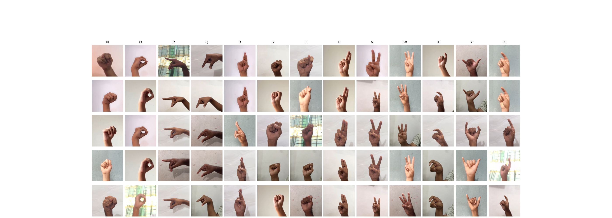

## B. Static Non-Cropped Labeled Images

### B01. Sign Language MNIST - Original (Github: [link](https://github.com/mon95/Sign-Language-and-Static-gesture-recognition-using-sklearn/blob/master/Dataset.zip))

- Author: [Sreehari Sreejith](https://github.com/mon95)
- License: [CC0: Public Domain](https://creativecommons.org/publicdomain/zero/1.0/)

- 1680 images
- 24 labels (['A', 'B', 'C', 'D', 'E', 'F', 'G', 'H', 'I', 'K', 'L', 'M', 'N', 'O', 'P', 'Q', 'R', 'S', 'T', 'U', 'V', 'W', 'X', 'Y'])
- 7 different people
- images 320x240 pixels
- All color images (3 channels)

Original dataset for Kaggle's [Sign Language MNIST](https://www.kaggle.com/datasets/datamunge/sign-language-mnist?resource=download)

Blog post: [sign language and static-gesture recognition using scikit-learn](https://www.freecodecamp.org/news/weekend-projects-sign-language-and-static-gesture-recognition-using-scikit-learn-60813d600e79)

> Gesture recognition is an open problem in the area of machine vision, a field of computer science that enables systems to emulate human vision. Gesture recognition has many applications in improving human-computer interaction, and one of them is in the field of Sign Language Translation, wherein a video sequence of symbolic hand gestures is translated into natural language.

> A range of advanced methods for the same have been developed. Here, we’ll look at how to perform static-gesture recognition using the scikit learn and scikit image libraries.

>This project involves the following steps. The links refer to the relevant code in the github repository.

> 1. Building the hand/not-hand dataset.
> 2. Converting all the images i.e., cropped sections with the gestures and the hand, not-hand images, to its vectorized form.
> 3. Building a binary classifier for detecting the section with the hand and building a multi-class classifier for identifying the gesture using these data sets.
> 4. Using the above classifiers one after the other to perform the required task.

> [Suks](https://www.facebook.com/sukriti10.tiwari) and I worked on this project as part of the Machine Learning course that we took up in college. A big shout out to her for all her contributions!

> Also, we wanted to mention Pyimagesearch, which is a wonderful blog that we used extensively while we were working on the project! Do check it out for content on image processing and opencv related content.

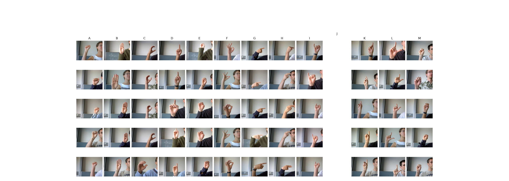
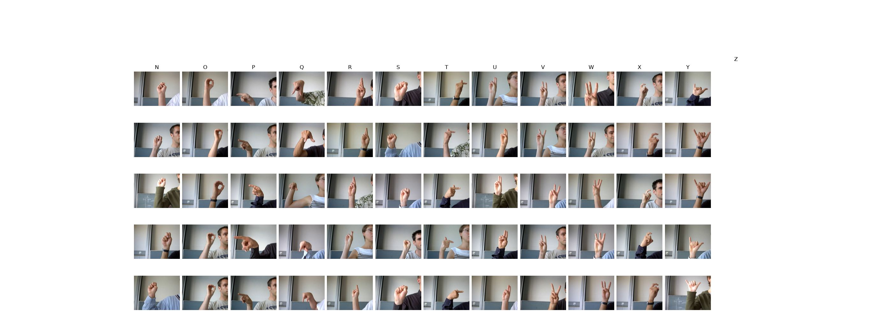

### B02. ASLYset (Mendeley: [link](https://data.mendeley.com/datasets/xs6mvhx6rh/1))

- Authors: Rivera, Miguel (2019), “ASLYset”, Mendeley Data, V1, doi: 10.17632/xs6mvhx6rh.1
- License: [CC BY-SA 4.0](https://creativecommons.org/licenses/by-sa/4.0/)

- 5,200 images
- 26 labels (['A', 'B', 'C', 'D', 'E', 'F', 'FN', 'G', 'H', 'I', 'K', 'L', 'M', 'N', 'O', 'P', 'Q', 'R', 'S', 'SP', 'T', 'U', 'V', 'W', 'X', 'Y'])
- 4 different people
- images 416x416 pixels
- All color images (3 channels)

This dataset consist in 5,200 images of size 416×416 obtained from four different persons, performing 24 ASL alphabet signs (whole alphabet excluding “J” and “Z”) and two additional signs called “SP” and “FN”, each volunteer generated 50 images for each of the 26 signs.

All of the images are labelled using YOLO format for training YOLO networks for object detection. Besides the here presented data was generated for training YOLO networks, it can be can be useful for training other computer vision algorithms (e.g. Faster R-CNN) by properly labelling images.

Images were extracted using the right hand at a varying distance (hand to camera) from 20 to 40 cm approximately, and moving the hand around the scene. Every image was labelled using the freely available software labelImg.

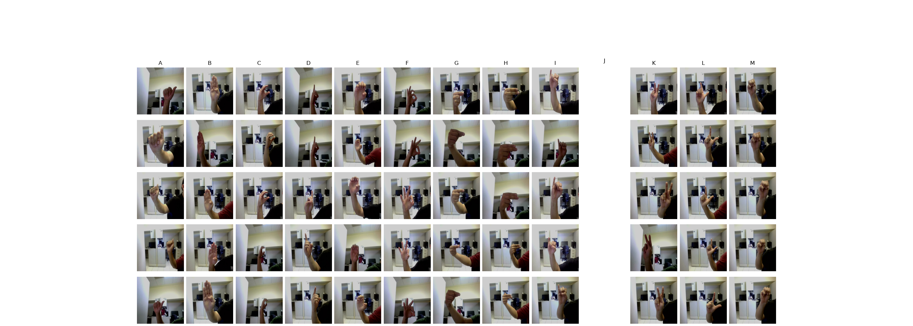
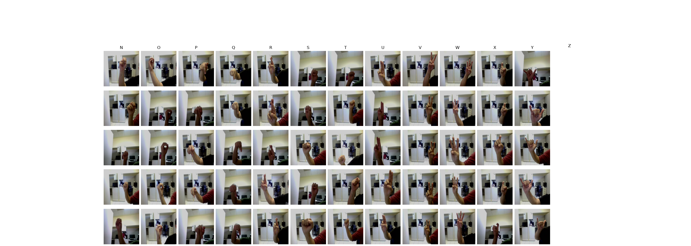
