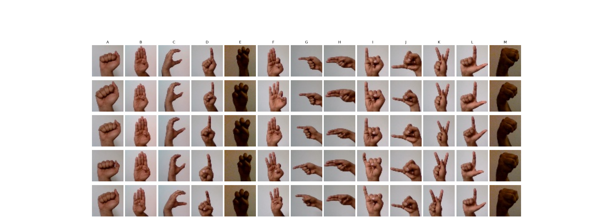
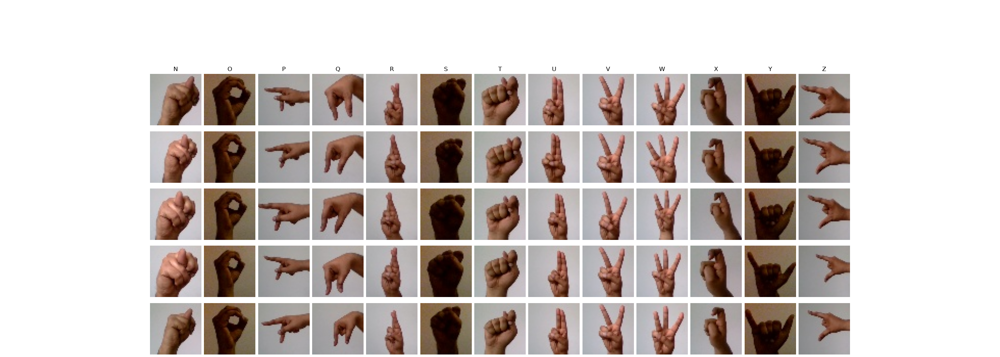

# A02 - Sign Language Gesture Images Dataset (Kaggle: [link](https://www.kaggle.com/datasets/ahmedkhanak1995/sign-language-gesture-images-dataset))

- Author: [Ahmed Khan](https://www.kaggle.com/ahmedkhanak1995)
- License: [EU ODP Legal Notice](https://ec.europa.eu/info/legal-notice_en)

- 55,500 images
- 37 labels (['0', '1', '2', '3', '4', '5', '6', '7', '8', '9', 'A', 'B', 'C', 'D', 'E', 'F', 'G', 'H', 'I', 'J', 'K', 'L', 'M', 'N', 'O', 'P', 'Q', 'R', 'S', 'T', 'U', 'V', 'W', 'X', 'Y', 'Z', '_'])
  - 10 numbers (0 to 9)
  - 26 letters (A-Z)
  - space
- images 50x50 pixels
- All color images (3 channels)

The dataset consists of 37 different hand sign gestures which includes A-Z alphabet gestures, 0-9 number gestures and also a gesture for space which means how the deaf or dumb people represent space between two letter or two words while communicating. The dataset has two parts, that is two folders (1)-Gesture Image Data - which consists of the colored images of the hands for different gestures.

Each gesture image is of size 50X50 and is in its specified folder name that is A-Z folders consists of A-Z gestures images and 0-9 folders consists of 0-9 gestures respectively, '_' folder consists of images of the gesture for space.

Each gesture has 1500 images, so all together there are 37 gestures which means there 55,500 images for all gestures in the 1st folder and in the 2nd folder that is (2)-Gesture Image Pre-Processed Data which has the same number of folders and same number of images that is 55,500. The difference here is these images are threshold binary converted images for training and testing purpose. Convolutional Neural Network is well suited for this dataset for model training purpose and gesture prediction.

