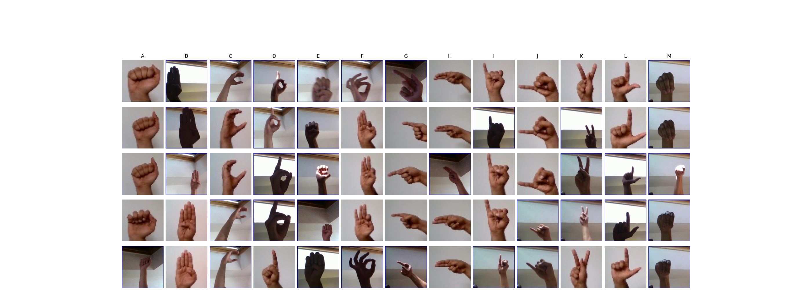
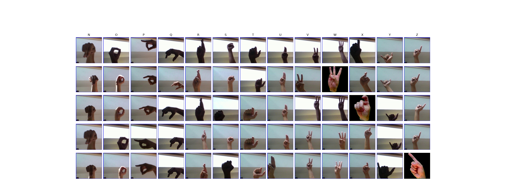

### A03 - American Sign Language (ASL) Dataset (Kaggle: [link](https://www.kaggle.com/datasets/prathumarikeri/american-sign-language-09az))

- Author: [Prathum Arikeri](https://www.kaggle.com/prathumarikeri)
- License: [CC BY-SA 4.0](https://creativecommons.org/licenses/by-sa/4.0/)

- 142,261 images
- 36 labels (['0', '1', '2', '3', '4', '5', '6', '7', '8', '9', 'A', 'B', 'C', 'D', 'E', 'F', 'G', 'H', 'I', 'J', 'K', 'L', 'M', 'N', 'O', 'P', 'Q', 'R', 'S', 'T', 'U', 'V', 'W', 'X', 'Y', 'Z'])
- images ranging from 50 to 400 in pixel width
- images from 50 to 400 in pixel height
- All color images (3 channels)

ASL dataset was created by combining author's self-made dataset with other small and large datasets found across GitHub and Kaggle.

