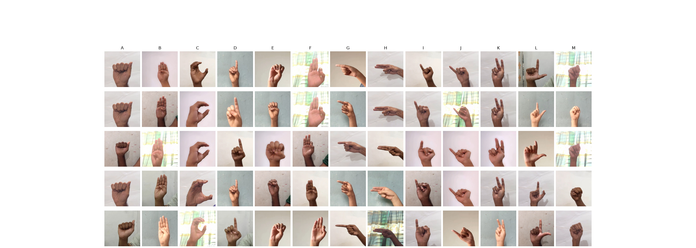
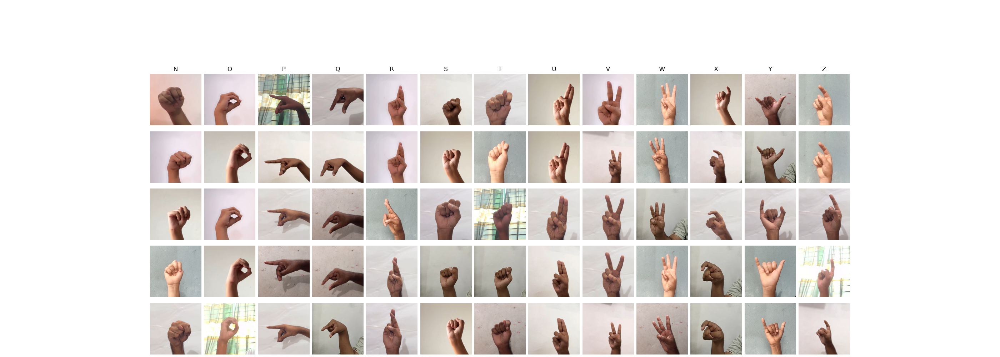

# A04 - ASL-HG: American Sign Language Hand Gesture Image Dataset (Mendeley: [link](https://data.mendeley.com/datasets/j4y5w2c8w9/1))

- Authors: Pranto, Md. Famidul Islam ; Islam, Md. Rifatul; Akbor, Md. Ali; Ghosh, Nabonita; Alam, Md. Rahatun; Chaki, Sudipto; Islam, Md Masudul (2025), “ASL-HG: American Sign Language Hand Gesture Image Dataset”, Mendeley Data, V1, doi: 10.17632/j4y5w2c8w9.1
- License: [CC BY-SA 4.0](https://creativecommons.org/licenses/by-sa/4.0/)

- 36,000 images
- 36 labels (['0', '1', '2', '3', '4', '5', '6', '7', '8', '9', 'A', 'B', 'C', 'D', 'E', 'F', 'G', 'H', 'I', 'J', 'K', 'L', 'M', 'N', 'O', 'P', 'Q', 'R', 'S', 'T', 'U', 'V', 'W', 'X', 'Y', 'Z'])
- 10 different people
- images 300x300 pixels
- All color images (3 channels)

This dataset provides a comprehensive collection of American Sign Language (ASL) hand gesture images designed to support research in gesture recognition, computer vision, deep learning, and assistive communication technologies. The dataset consists of 36,000 high-resolution JPG images across 36 ASL classes, covering the full English alphabet (A–Z) and digits (0–9).

Data were collected from 10 volunteers in Mirpur, Dhaka, Bangladesh during May–June 2025. Each participant contributed 100 images per class, producing a balanced dataset of 1,000 images for each gesture category. Images were captured using smartphone HD cameras in both indoor and outdoor environments to ensure diversity in lighting, backgrounds, skin tones, and hand orientations.

To avoid class confusion between the visually similar gestures for the letter “O” and the digit “0”, the dataset explicitly includes the standard two-handed ASL sign for “zero,” which is commonly used in real-world alphanumeric communication. This distinction supports more accurate gesture-based recognition across alphabetic and numeric classes.

With its balanced distribution, high quality, and dual-format availability (raw + processed), this dataset stands as a state-of-the-art ASL gesture resource. It is suitable for research in sign language recognition, assistive technology, human–computer interaction, gesture-controlled systems, and pattern recognition benchmarking.

#### ASL_Raw_Images.zip

1. Contains the original unprocessed gesture images.
2. Preserves natural variations in lighting, background, angle, and hand shape.

