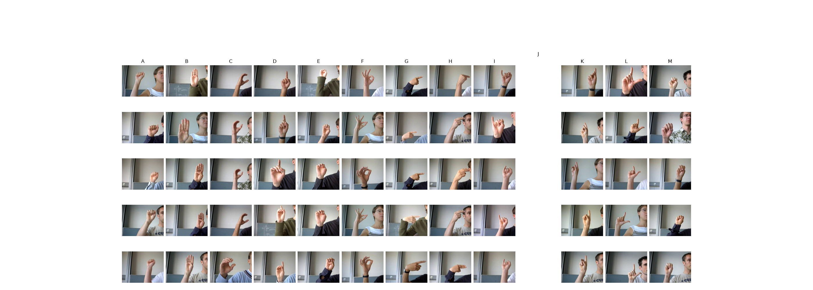
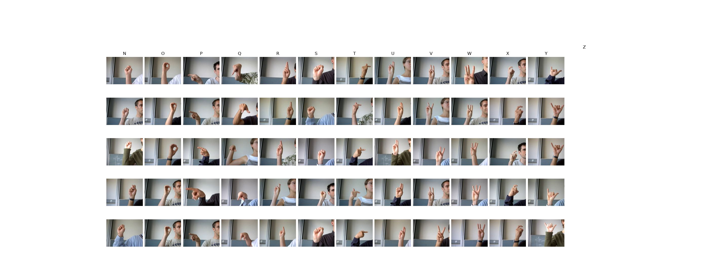

# B01. Sign Language MNIST - Original (Github: [link](https://github.com/mon95/Sign-Language-and-Static-gesture-recognition-using-sklearn/blob/master/Dataset.zip))

- Author: [Sreehari Sreejith](https://github.com/mon95)
- License: [CC0: Public Domain](https://creativecommons.org/publicdomain/zero/1.0/)

- 1680 images
- 24 labels (['A', 'B', 'C', 'D', 'E', 'F', 'G', 'H', 'I', 'K', 'L', 'M', 'N', 'O', 'P', 'Q', 'R', 'S', 'T', 'U', 'V', 'W', 'X', 'Y'])
- 7 different people
- images 320x240 pixels
- All color images (3 channels)

Original dataset for Kaggle's [Sign Language MNIST](https://www.kaggle.com/datasets/datamunge/sign-language-mnist?resource=download)

Blog post: [sign language and static-gesture recognition using scikit-learn](https://www.freecodecamp.org/news/weekend-projects-sign-language-and-static-gesture-recognition-using-scikit-learn-60813d600e79)

> Gesture recognition is an open problem in the area of machine vision, a field of computer science that enables systems to emulate human vision. Gesture recognition has many applications in improving human-computer interaction, and one of them is in the field of Sign Language Translation, wherein a video sequence of symbolic hand gestures is translated into natural language.

> A range of advanced methods for the same have been developed. Here, we’ll look at how to perform static-gesture recognition using the scikit learn and scikit image libraries.

>This project involves the following steps. The links refer to the relevant code in the github repository.

> 1. Building the hand/not-hand dataset.
> 2. Converting all the images i.e., cropped sections with the gestures and the hand, not-hand images, to its vectorized form.
> 3. Building a binary classifier for detecting the section with the hand and building a multi-class classifier for identifying the gesture using these data sets.
> 4. Using the above classifiers one after the other to perform the required task.

> [Suks](https://www.facebook.com/sukriti10.tiwari) and I worked on this project as part of the Machine Learning course that we took up in college. A big shout out to her for all her contributions!

> Also, we wanted to mention Pyimagesearch, which is a wonderful blog that we used extensively while we were working on the project! Do check it out for content on image processing and opencv related content.

