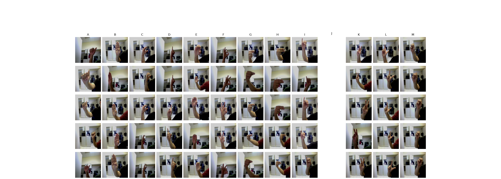
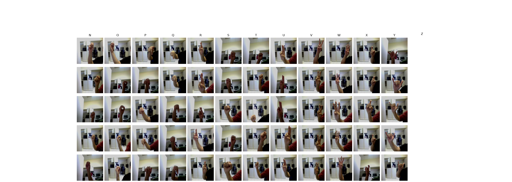

# B02. ASLYset (Mendeley: [link](https://data.mendeley.com/datasets/xs6mvhx6rh/1))

- Authors: Rivera, Miguel (2019), “ASLYset”, Mendeley Data, V1, doi: 10.17632/xs6mvhx6rh.1
- License: [CC BY-SA 4.0](https://creativecommons.org/licenses/by-sa/4.0/)

- 5,200 images
- 26 labels (['A', 'B', 'C', 'D', 'E', 'F', 'FN', 'G', 'H', 'I', 'K', 'L', 'M', 'N', 'O', 'P', 'Q', 'R', 'S', 'SP', 'T', 'U', 'V', 'W', 'X', 'Y'])
- 4 different people
- images 416x416 pixels
- All color images (3 channels)

This dataset consist in 5,200 images of size 416×416 obtained from four different persons, performing 24 ASL alphabet signs (whole alphabet excluding “J” and “Z”) and two additional signs called “SP” and “FN”, each volunteer generated 50 images for each of the 26 signs.

All of the images are labelled using YOLO format for training YOLO networks for object detection. Besides the here presented data was generated for training YOLO networks, it can be can be useful for training other computer vision algorithms (e.g. Faster R-CNN) by properly labelling images.

Images were extracted using the right hand at a varying distance (hand to camera) from 20 to 40 cm approximately, and moving the hand around the scene. Every image was labelled using the freely available software labelImg.

